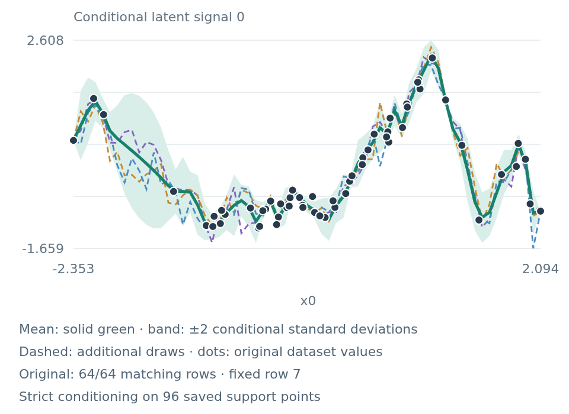
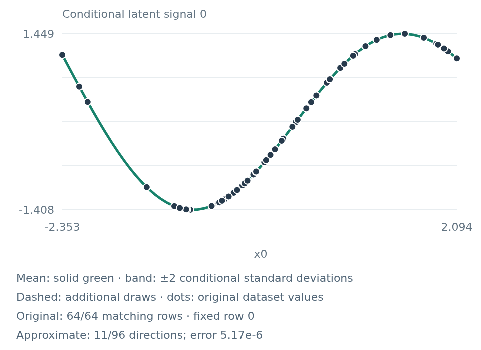

# Conditional GP explorer: local browser evidence

Application and browser procedure source:
`716d63068ebd9d9d95baaaec3736d92c7a9054fc`. A fresh server on port 8774 used
`/tmp/r0-gp-explorer-data-716d630`. A dedicated Chromium profile on port 9226 ran
the GP procedure and then the full explorer procedure, sequentially. Raw outputs
are in `/tmp/r0-gp-browser-716d630` and `/tmp/r0-explorer-browser-716d630`.
`files.json` records both groups' hashes and sizes. The GP receipt is retained as
`receipt.json`; the general receipt is retained as `explorer-receipt.json`.



The GP procedure checked a one-active-feature Matérn task with 64 dataset rows and
32 calibration rows. The plot separately renders 64 original points, a conditional
mean, a pointwise uncertainty band and three additional draws. The seed
`9223372036854775807` survives browser transport and JSON download exactly. Repeating
the request reproduces the result; changing only the draw seed changes the draws
while preserving the mean. An irrelevant-feature slice is constant with zero
uncertainty. Multiclass channel selection redraws the recorded channel.

A smooth RBF example visibly fails strict conditioning. Explicitly selecting
approximation produces a labelled result retaining 11 of 96 directions; the view
and exported chart show its measured projection error. The checkbox resets for
each new dataset. A 257-point request fails visibly instead of silently resizing.
Changed controls clear old results, including the downloadable JSON.



Actual SVG/PNG/JSON downloads were checked using browser completion events. The
JSON equals the inspected result. Exported SVG labels include strict/approximate
status and the legend. The extended background covers the entire exported chart.
Mobile layout has no document overflow. Browser exceptions were empty.

The complete explorer walkthrough also passed: all ten generator families and
generation graphs, nine analytic curves plus the GP conditional view, expanded
components, keyboard selection, chart exports, 64-component graph, task replay,
saved-task loading, large identities, failure preservation, mobile layout and the
20,000-by-256 dataset. These checks cover the extracted shared CDP helper as well.

Reproduce in separate terminals, using fresh output directories:

```bash
UV_PROJECT_ENVIRONMENT=/home/avist/Projects/r0/.venv \
OMP_NUM_THREADS=1 OPENBLAS_NUM_THREADS=1 MKL_NUM_THREADS=1 \
python3 scripts/run_check.py python scripts/explore.py \
  --out /tmp/r0-gp-explorer-data-716d630 --port 8774

chromium --headless --remote-debugging-port=9226 \
  --user-data-dir=/tmp/r0-gp-explorer-browser-profile about:blank

node scripts/gp_explorer_browser_smoke.mjs 9226 http://127.0.0.1:8774/ \
  /tmp/r0-gp-browser-716d630
node scripts/explorer_browser_smoke.mjs 9226 http://127.0.0.1:8774/ \
  /tmp/r0-explorer-browser-716d630
```

The actual run used Node v24.21.0 and the installed Playwright Chromium headless
shell; receipts retain its exact version. No npm package is required. The server
caches HTML at startup, so restart it after changing browser assets.

Before implementation, the public curve test failed because `inspect_gp_curve`
was missing. The actual browser against the previous application failed with
`conditional GP controls must exist`. The first working export left its legend on
a transparent background; an SVG extent check failed, and the final browser
procedure now checks the full background height. Those earlier attempts are not
the final-source evidence above.

At the recorded source, `make check` passed **457 tests, 1 CUDA skip**, in 107.34 s.
Then `make smoke` and `make eval-smoke` each exited 2 because the CLI does not
implement `train` or `eval`; no loss summary or evaluation table exists. Both
source review axes found no blocking issues.

The notebook pins the same source, and the UI is shared with Colab, but actual
hosted interaction remains **NOT_RUN**. No cloud run was launched. Controlled
pairs and the remaining coverage, batch-consumption and resource work in #27
remain pending; this is not overall issue completion.
