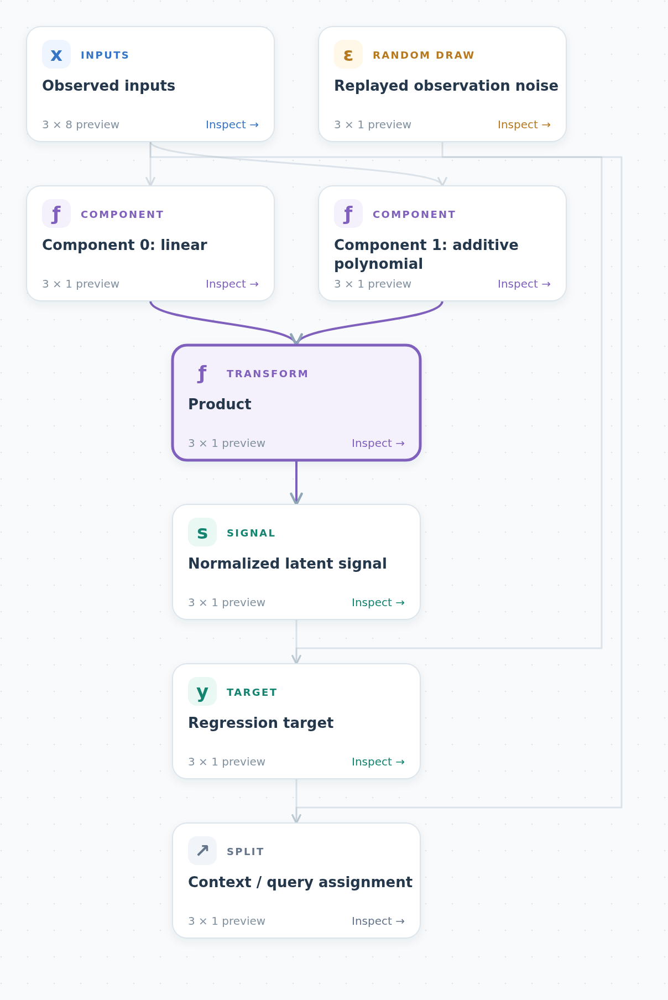
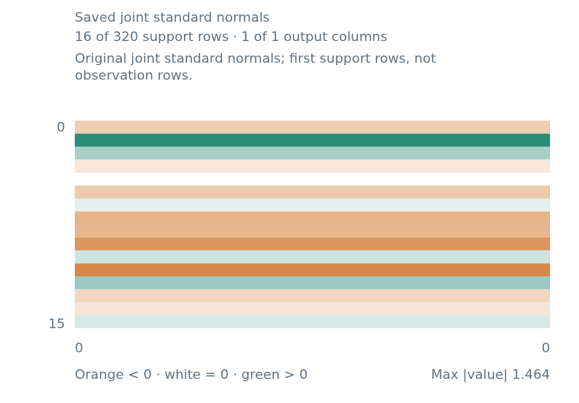

# Generation graph explorer: local browser evidence

Application and browser procedure source:
`923339d1032eb713c1b3b0151d145de305bc7916`. A fresh server on port 8771 used
`/tmp/r0-graph-beauty-final`; a dedicated Chromium profile on port 9225 drove it.
Raw outputs are in `/tmp/r0-graph-beauty-browser-923339d`. `files.json` records
their sizes and SHA-256 hashes; selected screenshots and the full browser receipt
are committed here. These are local Chromium results. Hosted Colab interaction
remains **NOT_RUN**, and CUDA is not available in this environment.



Before implementation, the session test failed with unknown action `graph`, and
the browser procedure against the previous UI failed because graph controls were
absent. The first working diagram was too spread out. The revised diagram uses
compact levels, distinct node colors, highlighted adjacent connections and zoom
controls. Edges still come from the recorded parents. No generator math changes
are part of this viewer.

Review found that the initial GP normal preview incorrectly reported 16 of 16
rows. The final view and exported heatmap report **16 of 320 support rows** for
the retained example, and explicitly distinguish support rows from observations.
The spec reviewer checked the counterexample again and closed that finding.



The final browser procedure passed for all ten graph families with zero root
reconstruction error. It checked composition expansion, keyboard Enter selection,
fit and reset controls, diagram and matrix SVG/PNG downloads, and a 64-component
graph whose PNG longest edge is capped at 4096 pixels. Mobile checks build a graph
before checking for document overflow. Existing curves, generation, replay, ZIP,
63-bit identities, stale-view protection, errors and 20,000-by-256 shape checks
also passed. Browser exceptions were empty. `receipt.json` retains the identities,
measurements and browser-confirmed download completion events.

Reproduce with fresh output directories and separate terminals:

```bash
UV_PROJECT_ENVIRONMENT=/home/avist/Projects/r0/.venv \
OMP_NUM_THREADS=1 OPENBLAS_NUM_THREADS=1 MKL_NUM_THREADS=1 \
python3 scripts/run_check.py python scripts/explore.py \
  --out /tmp/r0-graph-beauty-final --port 8771

chromium --headless --remote-debugging-port=9225 \
  --user-data-dir=/tmp/r0-graph-beauty-profile about:blank

node scripts/explorer_browser_smoke.mjs 9225 http://127.0.0.1:8771/ \
  /tmp/r0-graph-beauty-browser-923339d
```

The actual run used Node v24.21.0 and the installed Playwright Chromium headless
shell; the receipt records its exact browser version. No npm package is required.
The server caches HTML at startup: restart it after asset edits. Download checks
wait for browser completion events. The harness preserves separate small and
large diagram copies because Chromium overwrites repeated download filenames.

Earlier browser attempts are not final-source proof: one used a cached old page,
one raced a fixed download delay, and one assumed duplicate download filenames
would be renamed. A separate attempted GP preview check hit the stale-episode
guard while its shared backend changed; that attempt does not establish the
preview defect. The final run uses a dedicated server and browser profile.

At the recorded source, `make check` passed: **449 passed, 1 CUDA skip**, 87.05 s.
Then `make smoke` and `make eval-smoke` each exited 2 because the repository CLI
does not implement `train` or `eval`. No training loss or evaluation table exists.
Conditional GP inspection, controlled pairs and hosted Colab verification remain
pending issue #27 work. This evidence does not claim overall issue completion.
