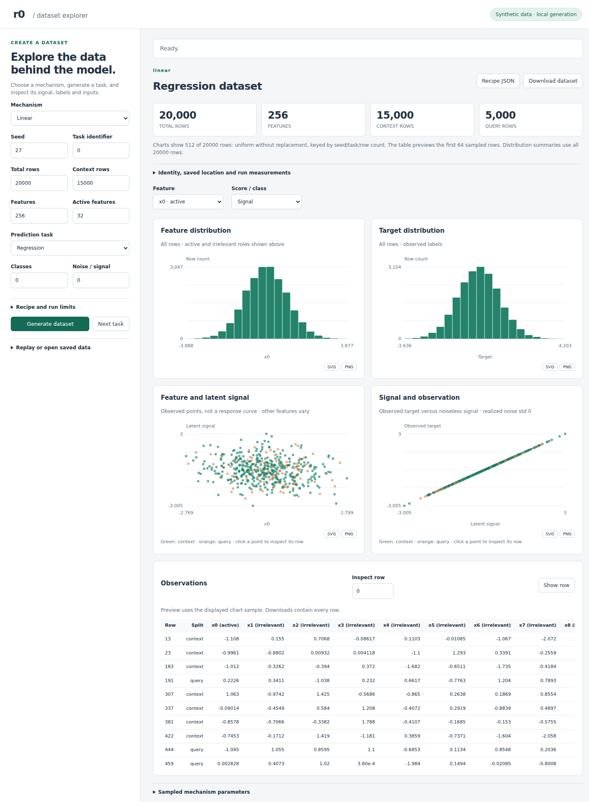
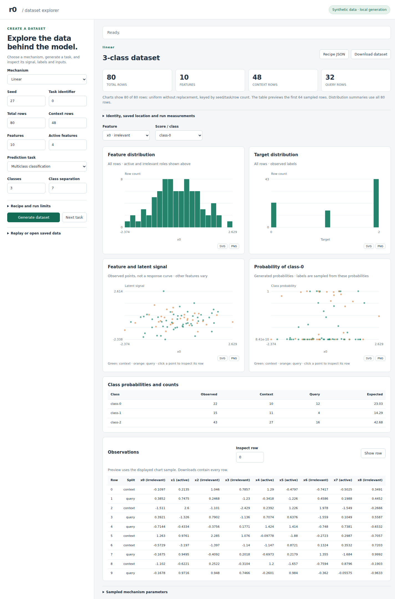

# Local dataset explorer evidence

Source and browser procedure: `e849b5414114c8fcf4b3df96ba0be8932f91b41b`.
Base dependency: saved-task loading at `64ec81fa8e8525a1a7a6adfc13aaf00f2adc68b6`.
This is local CPU/browser evidence, not hosted Colab or GPU acceptance.

## Reproduction

Use the commands in [local-dataset-explorer.md](../../local-dataset-explorer.md),
with an empty generation output directory and a separate Chromium profile.
The retained `scripts/explorer_browser_smoke.mjs` drives actual browser controls
through Chromium's debugging API. It writes screenshots, downloaded exports and
`receipt.json`. The receipt records browser/Node versions and generator measurements.

The recorded run used the shared environment through `scripts/run_check.py`,
one CPU thread, output `/tmp/r0-explorer-browser-e849b54`, port 8767, Chromium's
debugging port 9224 and proof directory `/tmp/r0-explorer-browser-e849b54-evidence`.
`files.json` records source identity, output locations, file sizes and SHA-256
hashes. Two screenshots and the unmodified receipt are retained here; the other
raw screenshots/downloads remain at the recorded local location and can be
recreated by the browser procedure.

## Observations and limits

- All ten starting recipes generated and displayed successfully. The first linear
  task was then reopened/resumed; its family-loop entry correctly reports zero
  new generations. That resume rate is not generator throughput.
- Browser actions exercised arbitrary row lookup, 63-bit identities, replay,
  opening saved data, ZIP/SVG/PNG downloads, classification counts and advanced
  recipe controls. Whole-parent components and explicitly mapped subsets remain
  valid under the tested control changes.
- A 20,000-row, 256-feature linear task displayed full-task histograms, 512 sampled
  chart rows and a 64-row table preview. The receipt contains its generation and
  persistence time and worker peak RSS. These exclude browser/parent-process memory
  and UI rendering time; they are one observation, not a repeated throughput study.
- The classification view checks horizontal chart-label bounds, including small
  probabilities. The mobile view checks page overflow. Screenshots were inspected
  by the author; automated geometry assertions do not establish general accessibility.
- Invalid recipe submission displays an error and preserves the previous displayed
  dataset. Python session tests separately reproduce startup timeout retention and
  complete saved-task/identity/export behavior.

## Review history

Spec review rejected `b291df9`: changing rows discarded class offsets/advanced
edits, and failures before worker initialization left no retained records.
The retained browser regression failed on offsets (`[]` instead of `[0,-2,1]`);
the startup-timeout test failed because no records existed. `b1ab2c8` fixed both,
but default composition active-count changes then failed validation. The browser
regression reproduced that failure; `ad49375` fixed whole-parent dependencies
without changing explicit subsets. Independent spec review closed all findings.
Standards review had no findings. The final numeric-label correction at `122cddb`
was separately reviewed. `3ad3050` binds row/parameter/export actions to the displayed
episode; the browser procedure simulates another client changing the active task
and checks stale-view rejection and recovery by replay. A later browser run
stalled on an idle HTTP connection; it produced partial screenshots but no success
receipt. A retained idle-socket probe reproduced the stall. `e849b54` accepts
connections independently while serializing dataset actions. The final browser
procedure passed, including that idle-socket check. Its proof is retained here. No historical rejection
is represented as a successful run.

Required checks: `make check` passed at the final application source, with 438
tests passed and one CUDA test skipped. `make smoke` followed by `make eval-smoke`
cannot run: CLI `train` and `eval` commands are not implemented. Both exit 2;
there is no training-loss summary or evaluation table. Expandable graphs, response
curves, paired comparisons and embedded Colab controls are still separate #27 work.
